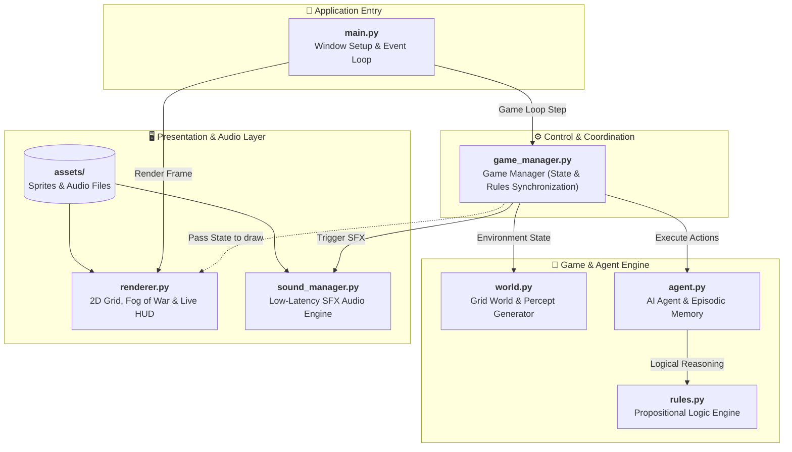
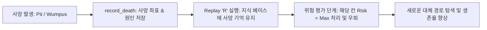

# 🧠 Agentic Wumpus World

### 불확실한 환경에서 살아남는 AI Agent

여러 개의 4×4 방으로 이루어진 던전(방 개수 1~6개 선택)에서 AI Agent가 **Breeze, Stench, Glitter, Scream** 등의 환경 신호(Percept)를 수집하여 지식 베이스(Knowledge Base)를 갱신하고, 명제 논리(Propositional Logic)와 BFS 탐색을 통해 안전한 경로를 추론하여 **Gold를 획득하고 무사히 탈출**하는 Agentic AI 프로젝트입니다.

---

## 📂 프로젝트 구조

```text
wumpus-world/
├── main.py                  # 🚀 프로그램 진입점 및 이벤트 루프
├── requirements.txt         # 📦 의존성 패키지 (pygame-ce 2.5.8)
├── game/                    # 🎮 핵심 게임 로직 & AI 엔진
│   ├── agent.py             # 🤖 AI Agent 클래스 (Perception, Memory, Decision, BFS)
│   ├── rules.py             # 📜 명제 논리 추론 엔진 (Knowledge Base & Risk Evaluation)
│   ├── world.py             # 🗺️ 다중 방 던전(벽·문·입구·출구), 위험 요소(Pit/Wumpus), 지각 신호 생성
│   └── game_manager.py      # ⚙️ 게임 흐름 동기화, 점수 계산 및 게임 모드 제어
├── ui/                      # 🖥️ UI & 오디오 렌더링
│   ├── renderer.py          # 🎨 방 화면, 미니맵, Agent 패널, 결과 모달 렌더링
│   ├── dev_panel.py         # 📊 드래그 가능한 Analytics 창 (Dev mode)
│   ├── controls.py          # 🎛️ 하단 컨트롤 바 (버튼, 스위치, 방 개수 선택)
│   ├── widgets.py           # 🧩 Button / Switch / Segmented / Stepper 위젯
│   ├── painter.py           # ✏️ 텍스트·도형·태그 드로잉 헬퍼
│   ├── (game/i18n.py)       # 🌐 영어 / 한국어 UI 문자열
│   ├── theme.py             # 🌗 Arco Design 스타일 라이트/다크 테마 토큰
│   └── sound_manager.py     # 🔊 저지연 오디오 시스템 (Breeze, Stench, Glitter, Scream, Door, Pit, Wumpus, Gold)
└── assets/                  # 🖼️ 고화질 2D 스프라이트 및 사운드 에셋
    ├── hero.png, door.png, floor.png, wumpus.png, pit.png, gold.png...
    └── sounds/              # 🎵 16-bit PCM WAV 사운드 이펙트
        ├── breeze.wav, stench.wav, glitter.wav, scream.wav, door.wav, pit.wav, wumpus.wav, gold.wav
```

| 모듈 / 파일            | 역할                                                                                              |
| :--------------------- | :------------------------------------------------------------------------------------------------ |
| `main.py`              | 🚀 Pygame 초기화, 윈도우 생성, 마우스/키보드 이벤트 분기 및 메인 루프 실행                        |
| `game/world.py`        | 🗺️ 다중 방 던전 생성(클래식 맵/랜덤 맵), 문으로 연결된 방, Pit/Wumpus/Gold 배치, 화살 궤적 계산 및 Percept 발생 |
| `game/agent.py`        | 🤖 AI Agent 상태 관리, 인지-추론-행동 루프, 에피소드 사망 기억(Episodic Memory), BFS 최단 경로 탐색 |
| `game/rules.py`        | 📜 명제 논리 기반 지식 추론, 과거 실패 기억 통합(`death_memory`), 위험도 점수(`Risk Score`) 산출   |
| `game/game_manager.py` | ⚙️ World와 Agent 상호작용 동기화, 사망 원인 기록(`record_death`), Replay 메모리 보존 제어          |
| `ui/renderer.py`       | 🖥️ 현재 방 화면, 던전 미니맵, 시야 안개(Fog of War), AI 사고 과정 및 Agent 패널 렌더링          |
| `ui/controls.py`       | 🎛️ 마우스로 조작하는 하단 컨트롤 바 (AI 실행, 맵, 수동 조작, 보기 설정)                          |
| `ui/sound_manager.py`  | 🔊 지각 신호(Breeze/Stench/Glitter), 탈출(Door), 사망(Pit/Wumpus), 비명(Scream) 저지연 오디오 재생 엔진 |
| `assets/`              | 🎨 던전 타일, 캐릭터, 몬스터, 지각 신호 스프라이트 및 효과음(.wav) 리소스                           |

---

## 🏗️ Architecture



---

## 🎮 Game Concept & Rules

AI Agent는 동굴을 탐험하며 각 칸에서 감각 정보(**Percept**)를 획득하고, 이를 바탕으로 위험을 피해 임무를 완수해야 합니다.

### 1. 환경 지각 신호 (Percepts) & 객체

| 아이콘 / 요소 | 명칭                   | 의미 및 규칙                                                            |
| :-----------: | :--------------------- | :---------------------------------------------------------------------- |
|      🌬️       | **Breeze (바람)**      | 상/하/좌/우 인접 칸에 Pit(함정)이 존재함을 감지                         |
|      👃       | **Stench (악취)**      | 상/하/좌/우 인접 칸에 Wumpus(괴물)가 살아있음을 감지                    |
|      ✨       | **Glitter (반짝임)**   | 현재 위치한 칸에 Gold(금괴)가 존재함                                    |
|      😱       | **Scream (비명)**      | Agent가 쏜 화살에 Wumpus가 명중하여 처치되었을 때 동굴 전체에 울려 퍼짐 |
|      🚪       | **Exit (출구)**        | 입구에서 가장 먼 방에 위치. 입구로는 나갈 수 없으며, Gold를 들고 출구에서 탈출(`CLIMB`)하면 승리 |
|      🔷       | **Door (방 사이 문)**  | 이웃한 방을 연결. 양방향 이동 가능. 문과 그 주변 칸에는 위험 요소가 없음 |
|      ❌       | **Pit (함정)**         | 빠지면 즉시 사망 및 게임 오버 (-1000점)                                 |
|      👹       | **Wumpus (괴물)**      | 마주치면 즉시 사망 및 게임 오버 (-1000점). 화살로 사냥 가능             |
|      🏹       | **Arrow (화살)**       | Agent가 단 1발 보유. 직선 경로로 날아가 Wumpus를 제거                   |

### 2. 점수 규칙 (Scoring System)

- **Gold 획득 후 무사 탈출 (Victory)**: `+1,000점`
- **매 행동당 이동 비용 (Step Penalty)**: `-1점`
- **화살 발사 비용 (Shoot Arrow)**: `-10점`
- **Wumpus 처치 보너스 (Slay Wumpus)**: `+500점`
- **Pit 추락 또는 Wumpus에 피격 (Game Over)**: `-1,000점`

---

## 🤖 AI Agent 추론 및 결정 메커니즘

Agent는 불확실한 부분 관측 환경(POMDP)에서 다음과 같은 **5단계 인지 순환 루프**를 거쳐 행동합니다.

```text
[ 1. Perception ]  -->  [ 2. Memory Update ]  -->  [ 3. Logic Deduction ]
                                                            │
[ 5. Action Execution ]  <--  [ 4. Decision & Pathfinding ]  ┘
```

### 1. 명제 논리 지식 베이스 (Knowledge Base)

- **Safe Cells ($Safe = PitFree \cap WumpusFree$)**:
  - Breeze가 없는 방문 셀의 인접 칸은 모두 **Pit-Free**.
  - Stench가 없는 방문 셀의 인접 칸은 모두 **Wumpus-Free** (Wumpus 사망 시 전체 맵이 Wumpus-Free).
- **Wumpus 위치 확정 (Single Wumpus Assumption)**:
  - Wumpus는 세계에 단 1마리만 존재하므로, 감지된 Stench들의 후보군 교집합(Intersection) 크기가 1이 되는 순간 Wumpus의 좌표가 확정됩니다.
- **Pit 위치 확정**:
  - Breeze가 감지된 셀의 미방문 인접 셀 중, Pit-Free가 아닌 후보 셀이 1개만 남으면 해당 셀은 100% Pit으로 확정됩니다.

### 2. 행동 우선순위 (Decision Hierarchy)

1. **Gold 획득 (`GRAB`)**: 현재 칸에 Glitter 감지 시 즉시 금괴 획득.
2. **출구로 탈출 (`CLIMB`)**: Gold 소지 시, 안전 경로(BFS)를 통해 출구(입구와 다른 칸)로 이동 후 던전 탈출.
3. **안전 구역 탐색 (`EXPLORE_SAFE`)**: 확정된 안전 미방문 셀 중 가장 가까운 목표로 안전 경로(BFS) 탐색 후 이동.
4. **Wumpus 사냥 (`SHOOT`, +500점)**: 안전 탐색이 끝난 뒤, 위험을 감수하기 전에 실행. Wumpus 위치가 확정되었거나 후보 칸이 모두 같은 방의 한 직선 위에 있으면(빗나갈 수 없는 사격) 사선으로 이동 후 발사. Gold를 든 상태에서도 사격 위치가 4걸음 이내면 보너스를 위해 들렀다 갑니다.
5. **전역 경계선 위험 감수 (`GLOBAL_FRONTIER_RISK`)**: 100% 안전한 미탐색 칸이 없는 경우, 현재 위치에 국한되지 않고 기방문 영역의 **전체 미개척 경계선(Global Frontier)**을 스캔하여 맵 전체에서 위험 점수(Risk Score)가 가장 낮은 최적 후보지로 안전 재배치 후 진입 (과거 사망 칸은 배제).
6. **완전 고립 시 탈출 (`RETREAT`)**: 더 이상 탐색할 곳이 없으면 Gold 없이 출구로 이동해 탈출. 출구까지 안전한 길도 없으면 `TRAPPED` 상태로 종료.

### 3. 🧠 에피소드 사망 기억 및 적응 학습 (Episodic Memory & Failure Learning)

동일 맵을 다시 플레이할 때 Agent가 같은 실수를 반복하지 않도록 **Cross-Episode Death Memory** 메커니즘을 지원합니다.



- **사망 원인 학습 (`record_death`)**:
  - **Pit 추락 (`FALL_IN_PIT`)**: 사망한 좌표 `(r, c)`를 `confirmed_pits`로 즉시 각인.
  - **Wumpus 피격 (`EATEN_BY_WUMPUS`)**: 사망한 좌표 `(r, c)`를 `confirmed_wumpus`로 각인하여 다음 판에서 원거리 저격 기회를 모색.
- **Replay 적응 (`[R]`)**:
  - Replay 시 지각/이동 기록은 초기화되지만, 해당 맵에서 학습한 `death_memory`는 유지됩니다.
  - 100% 안전한 셀이 없어 위험을 감수해야 할 때, **이전에 죽었던 셀을 우선순위에서 완전히 제외**하고 다른 대체 분기 경로로 우회합니다.
- **메모리 수명 주기 (Lifecycle)**:
  - `[R] Replay`: 현재 맵의 사망 기억 유지 (반복 학습).
  - `[M] Random Map` / `[D] Default Map`: 다른 세계로 이동하므로 사망 기억 완전 초기화 (`clear_death_memory`).

---

## 🖥️ UI & Visualization 기능

[Arco Design System](https://www.figma.com/community/file/1053233047330321743/arco-design-system) 스타일의 깔끔한 카드 레이아웃입니다.

- **좌측 상단 – 방 화면**: Agent가 있는 방을 픽셀 아트로 표시. 미탐색 칸은 안개, 추론된 안전 칸은 `SAFE`, 확정된 위험은 `PIT` / `WUMPUS` 태그. 다른 방으로 통하는 문은 가장자리의 파란 `R2` 표시.
- **우측 상단 – 던전 미니맵**: 모든 방과 문, 방문한 칸, 입구/출구, Agent 위치. 방을 클릭하면 해당 방을 미리 볼 수 있습니다.
- **Agent 패널**: 점수·걸음·Gold·화살, 현재 감각 신호, AI 추론 과정, 이벤트 로그.
- **하단 컨트롤 바**: 키보드 없이 마우스로 모든 조작 가능.
- **라이트 / 다크 테마** 전환.
- **언어 전환 (EN / 한국어)**: 하단 보기 그룹에서 전환. 버튼, 패널, AI 추론, 로그까지 모두 즉시 바뀝니다. 한국어는 Helvetica Neue와 어울리는 macOS 기본 글꼴 Apple SD Gothic Neo로 표시됩니다.

---

## ⌨️ 조작 안내 (Controls)

모든 기능은 하단 컨트롤 바에서 마우스로 사용할 수 있으며, 아래 단축키도 그대로 동작합니다.

|                      키 (Key)                       | 화면 컨트롤                  | 설명                                                                |
| :-------------------------------------------------: | :--------------------------- | :------------------------------------------------------------------ |
|                  <kbd>SPACE</kbd>                   | **Step**                     | AI Agent가 다음 1단계를 추론하고 행동합니다.                        |
|                    <kbd>A</kbd>                     | **Auto play** 스위치         | AI가 스스로 연속 탐색합니다. 속도는 Slow / Normal / Fast.           |
|                    <kbd>M</kbd>                     | **New map**                  | 선택한 방 개수로 새 던전을 생성하며 사망 기억을 초기화합니다.       |
|                    <kbd>R</kbd>                     | **Replay**                   | 같은 맵을 다시 플레이하며 **사망 기억(Episodic Memory)을 계승**합니다. |
|                    <kbd>D</kbd>                     | **Classic**                  | 원래의 4×4 클래식 맵(입구 (3,0), 출구 (0,3))을 로드합니다.          |
|             <kbd>+</kbd> / <kbd>-</kbd>             | **Rooms** − / +              | 방 개수(1~6)를 바꾸고 새 던전을 생성합니다.                         |
| <kbd>↑</kbd> <kbd>↓</kbd> <kbd>←</kbd> <kbd>→</kbd> | 방향 버튼                    | 수동 이동. 벽은 통과할 수 없고 문으로만 다른 방에 갈 수 있습니다.   |
| <kbd>Shift</kbd> + 방향키                           | **Shoot mode** + 방향 버튼   | 해당 방향으로 화살 발사 (1회, 같은 방 안에서만 날아감).             |
|                    <kbd>G</kbd>                     | **Grab gold**                | 현재 칸의 Gold를 획득합니다. 출구 칸에 들어서면 즉시 탈출하며 게임이 끝납니다 (입구로는 나갈 수 없음). |
|                   <kbd>TAB</kbd>                    | **Reveal map** 스위치 (방 카드 상단) | 안개를 걷고 전체 맵의 실제 상태를 표시합니다.                |
|                    <kbd>L</kbd>                     | **EN / 한국어**              | 인터페이스 언어 전환.                                               |
|                    <kbd>T</kbd>                     | **Dark theme** 스위치        | 라이트 / 다크 테마 전환.                                            |
|                          –                          | **Sound** 스위치             | 효과음 켜기 / 끄기.                                                 |

---

## 📊 Dev mode (Analytics)

Agent 패널의 **Analytics** 버튼(또는 <kbd>F1</kbd>)을 누르면 드래그 가능한 분석 창이 열립니다.

- **Current game**: 결과, 걸음 수, 탐색률, 결정당 사고 시간(평균/최대 ms), 위험 이동 횟수, 문 통과, 화살 사용, 경과 시간
- **Session**: 이번 실행에서 끝난 게임 수, 승률, Pit/Wumpus 사망률, 평균 점수·걸음·탐색률
- **Benchmark**: 선택한 알고리즘으로 50/100/250 게임을 그래픽 없이 실행. **모든 알고리즘이 같은 맵 세트**에서 테스트되므로 결과를 바로 비교할 수 있습니다.

자신의 알고리즘을 비교하려면 `game/algorithms.py`에서 `Agent`를 상속해 `decide_next_action`을 구현하고 `ALGORITHMS`에 추가하세요. 예시로 위험을 전혀 감수하지 않는 `Safe only` 기준 알고리즘이 들어 있습니다.

터미널에서도 실행할 수 있습니다:

```bash
python -m game.benchmark --games 200 --rooms 3
```

---

## 🛠️ Tech Stack

| 기술                | 용도              | 설명                                                        |
| :------------------ | :---------------- | :---------------------------------------------------------- |
| 🐍 **Python 3.10+** | Core Logic        | 게임 환경 및 AI Agent 구현                                  |
| 🎮 **pygame-ce 2.5.8** | Graphics & Audio  | 60 FPS 2D 렌더링, Retina(High-DPI) 지원, 입력 이벤트 처리 |
| 🧠 **Symbolic AI**  | Knowledge & Logic | 명제 논리(Propositional Logic), 지식 베이스 추론            |
| 🧭 **Algorithms**   | Pathfinding       | BFS(너비 우선 탐색) 최단 경로 알고리즘, Risk Score 휴리스틱 |

---

## 🚀 실행 방법

### 1. 저장소 클론 (Clone Repository)

```bash
git clone https://github.com/OnlyDev321/wumpus-world.git
cd wumpus-world
```

### 2. 가상환경 생성 및 활성화

> Python **3.10 ~ 3.14** 중 아무 버전이나 사용 가능합니다 (권장: 3.14, `.python-version` 참고).
> 가상환경(`.venv`)은 Git에 올리지 않습니다. 컴퓨터마다 직접 새로 만드세요.
> 폰트(Pretendard)는 `assets/fonts`에 포함되어 있어 macOS / Windows / Linux에서 동일하게 보입니다.

**macOS / Linux**

```bash
python3 -m venv .venv
source .venv/bin/activate
```

**Windows**

```bash
python -m venv .venv
.venv\Scripts\activate
```

### 3. 패키지 설치

```bash
pip install -r requirements.txt
```

### 4. 프로그램 실행

```bash
python main.py
```

---

## 🎯 Project Goal

이 프로젝트의 핵심 목표는 단순한 2D 미니게임을 넘어,

> **"불확실한 환경(Partial Observability) 속에서 지각(Perceive)하고, 기억(Memory)하며, 논리적으로 추론(Reason)하여 최적의 생존 및 목표 행동(Action)을 결정하는 Agentic AI의 근본 원리를 구현하고 시각화하는 것"**

입니다.
